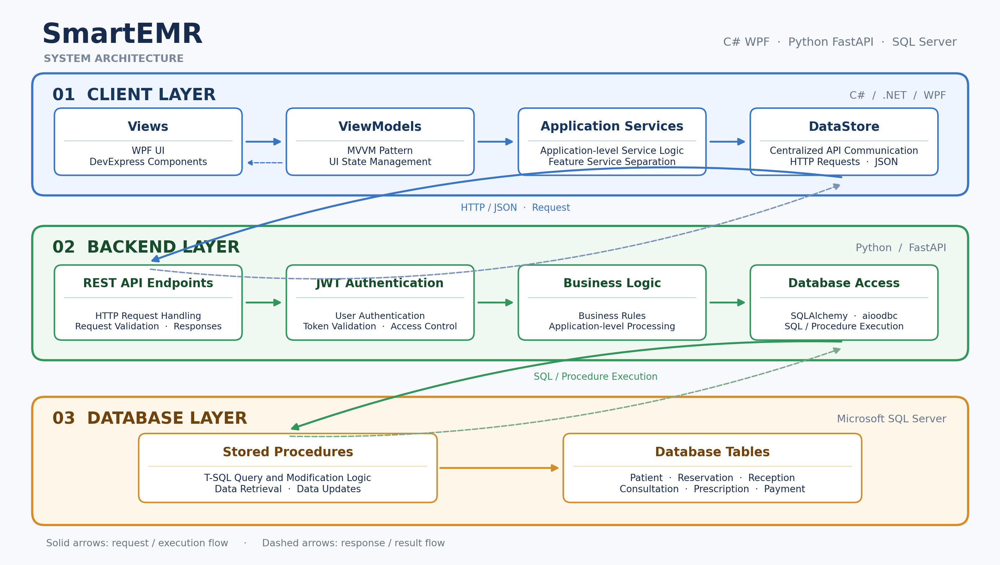
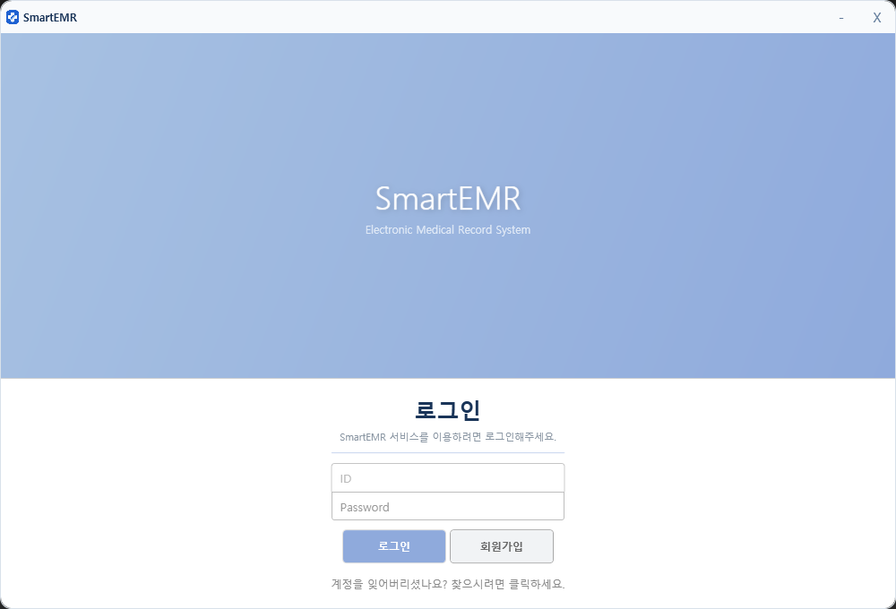
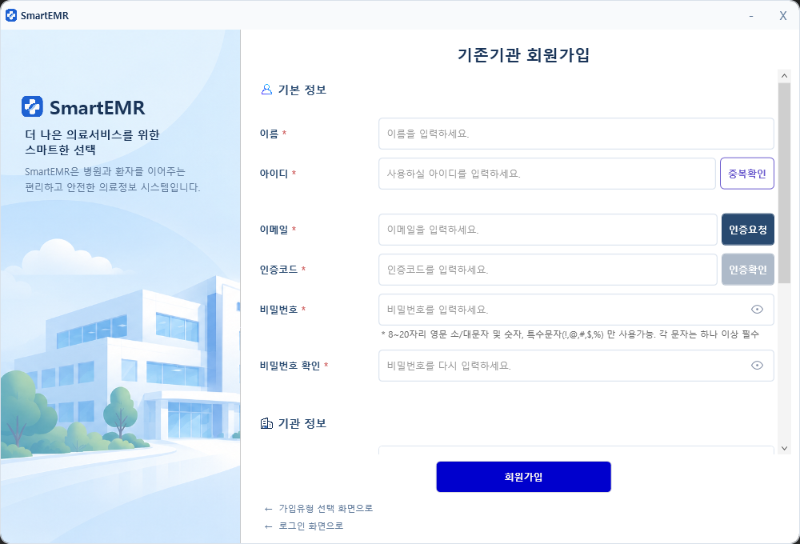
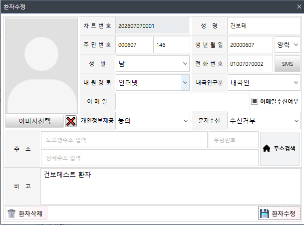
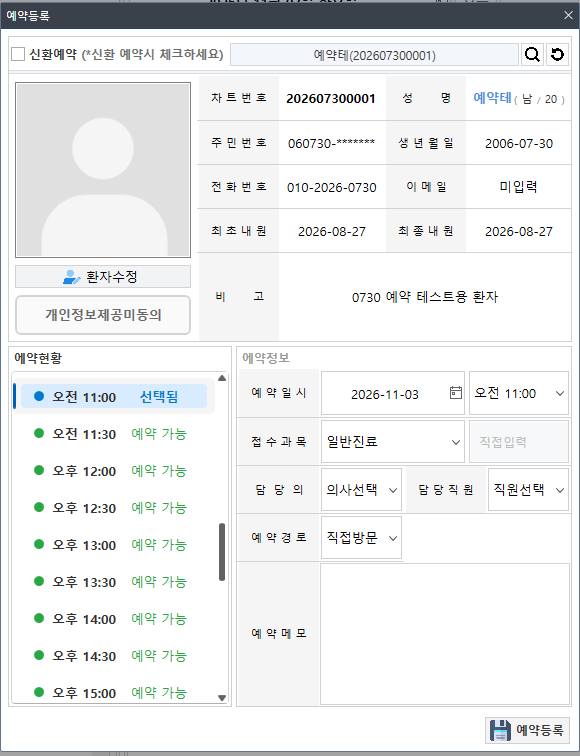
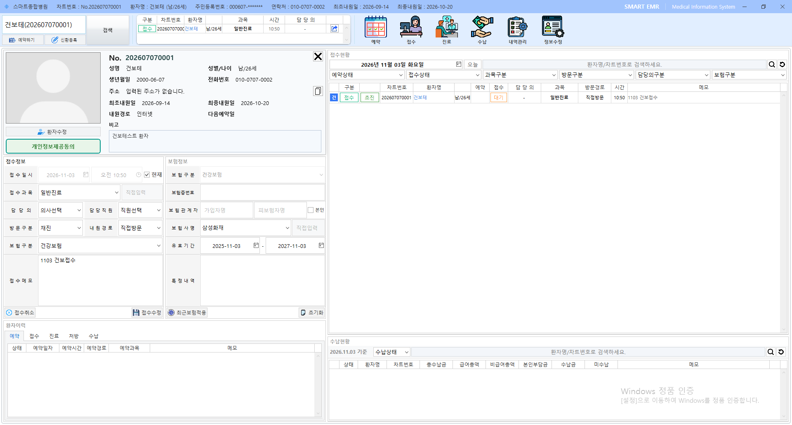
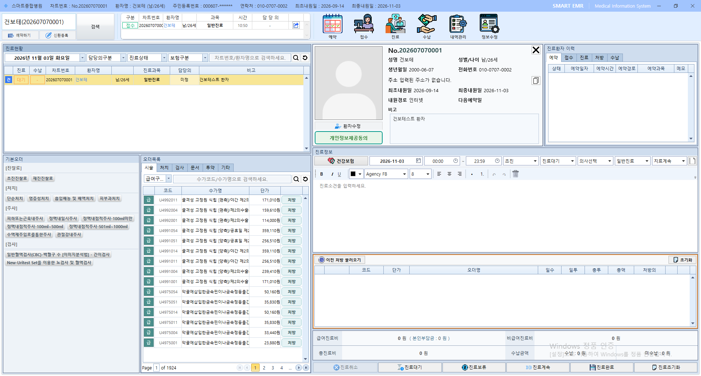
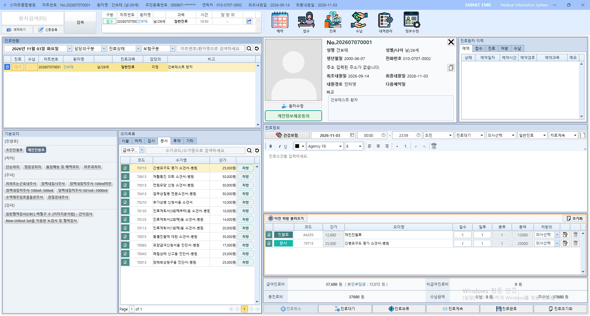

# SmartEMR

## 1. 프로젝트 소개
SmartEMR은 의료기관의 환자 관리부터 예약, 접수, 진료, 처방 및 수납까지 연결되는 업무 흐름을 통합적으로 관리하기 위해 개발한 EMR 시스템입니다.
실제 의료정보 시스템 개발 및 유지보수 경험을 바탕으로 기존 업무 프로세스를 재구성하고, WPF 클라이언트와 FastAPI 백엔드를 분리한 구조로 시스템을 설계 및 구현하였습니다.

## 2. 프로젝트 개요
 - **프로젝트명** : SmartEMR
 - **개발 형태** : 개인 프로젝트
 - **개발 기간** : 약 6개월
 - **개발 인원** : 1명
 - **담당 업무** : 프로젝트 기획 및 데이터베이스 설계, 클라이언트/백엔드 개발 및 연동
 - **프로젝트 유형** : 의료기관 업무 관리 시스템

## 3. 기술 스택
 - **Client** : C#/WPF, MVVM, DI
 - **Backend** : Python/FastAPI, SQLAlchemy, aioodbc, JWT
 - **Database** : Microsoft SQL Server, Stored Procedure·Relational Data Modeling
 - **Tools & Integration** : Visual Studio/Visual Studio Code, Git, WebView2, NaverPay API

## 4. 주요 기능
 - **환자 관리** : 환자 등록/수정, 검색, 이력 조회
 - **예약 관리** : 예약 등록/수정, 예약 현황(캘린더), 이력 조회
 - **접수 관리** : 접수 등록/수정, 이력 조회
 - **진료 관리** : 접수·진료간 연계 및 진료 저장, 이력 조회
 - **처방 관리** : 진료 처방 등록/수정, 이력 조회
 - **수납 관리** : 진료 단위 수납 정보 관리 및 결제 처리, 이력 조회
 - **외부 연동** : 수납 네이버페이 결제 연동

 ## 5. 기술적 개선 사항
 1. **WPF 클라이언트 아키텍처 개선**
  - MVVM 패턴 기반으로 View 와 ViewModel 의 역할을 분리하고 화면과 비즈니스 로직 간 결합도 최소화
  - 전역 서비스 로케이터 방식으로 관리하던 서비스 접근 구조를 DI 기반으로 변경하여 의존성 관리 개선
  - DataStore 와 Service의 역할을 분리하여 일관된 API 호출 방식을 구성하고, 데이터 처리 및 화면 갱신 책임을 구분

 2. **클라이언트와 백엔드 간 역할 분리**
  - WPF 클라이언트와 FastAPI 백엔드를 분리하고 HTTP 요청을 통한 연계 구조 구현
  - FastAPI에서 데이터 조회 및 저장, JWT 인증을 처리하고 클라이언트는 화면 및 사용자 입력 중심으로 구성
  - 공통 응답 구조(ServiceResult) 를 활용하여 API 처리 결과와 오류 메세지를 클라이언트에 전달

 3. **의료 업무 흐름을 고려한 데이터 구조 설계**
  - 환자, 예약, 접수, 진료, 처방, 수납 간 관계를 고려하여 DB 구조 설계
  - 예약 -> 접수, 접수 -> 진료로 이어지는 데이터 흐름을 정리하고 각 데이터 간 상태를 분리하여 관리
  
 4. **외부 결제 시스템 연동**
  - WebView2를 활용하여 네이버페이 결제 화면과 WPF 클라이언트 연동
  - 결제 요청부터 승인 결과 처리 및 내부 수납 데이터 반영까지의 연계 흐름 구현

## 6. 시스템 아키텍처
  
 
## 7. 주요 화면
### 로그인 화면

### 회원가입 화면

### 환자

### 예약 및 접수

### 진료 및 처방

### 수납
